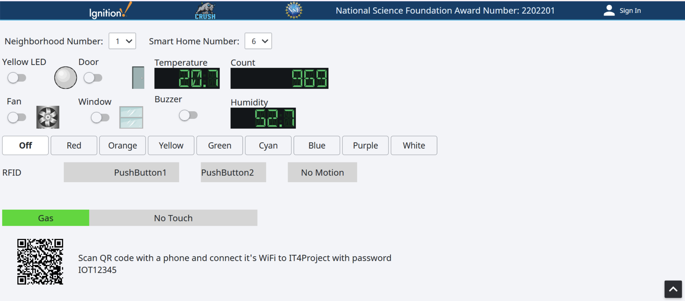
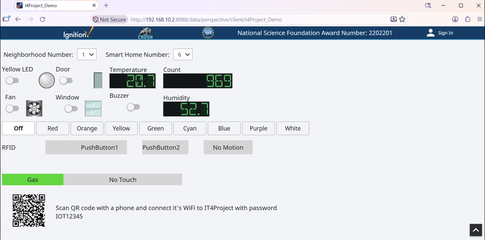
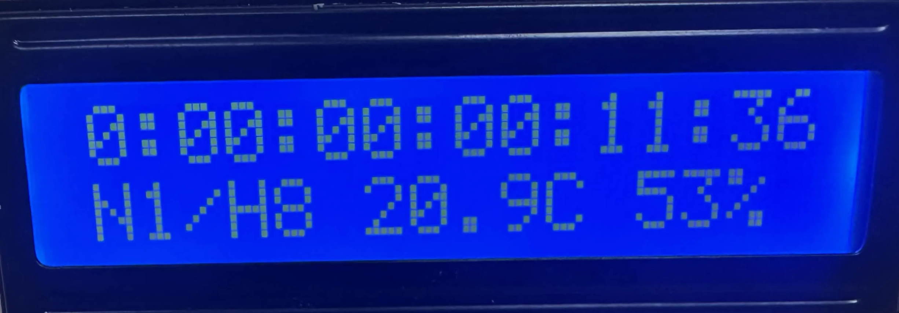

[Back to Main Menu](https://github.com/CCC-Industry4/IIOT-4.0-Project/tree/main)

*Instruction to the teacher: Conduct the following activities as a class. Choose one student to read aloud the instructions below. Assign other students to carry out the steps to set up the Raspberry Pi, Smart Home, and PC.*
# Setup Raspberry Pi, Arduino Smart Home, and PC
---
1. **Plug-in / Power Up**  Raspberry Pi. During power up the system is loading the SCADA software on the Pi.  After about three minutes the following screen will appear on the web browser.

   *While the system is starting up, you can watch this [video](https://youtu.be/7RWmfIVDkN8?si=ezeVmTGk_68My3a-) by Inductive Automation to learn what a SCADA system is. The platform of this system would cost ~$20,000 for industry, but thankfully Inductive Automation is freely sharing this software for educational purposes.*
   
   After the Ignition SCADA software has started the Pi should have the following webpage open:
   

2. **Connect** the demonstration PC to the Pi. You can use either of the following methods to connect:
   - **Ethernet cable** connected from PC to a small gray Wi-Fi router on the port labeled as WAN (actually configured as a second LAN port), providing a straightforward method to access the system. Ensure your Ethernet settings are configured to obtain an IP address automatically (refer to [troubleshooting](https://github.com/CCC-Industry4/StarterGuide/blob/2bf8fd24f25495de3f9bb1f01953807beb0b81df/08_troubleshooting.md) for assistance with this setting). If administrative privileges are not available, consider using the Wi-Fi connection instead.
   - **Wi-Fi** can be used on a PC or smartphone. The disadvantages of using Wi-Fi are that you will lose access to the internet. Connect to the following:
      - **SSID (service set identifier):** IT4Project
      - **Password:** IOT12345
3. **Open a web browser** on PC using this link:  
   http://192.168.10.2:8088/data/perspective/client/I4Project_Demo

4. You should now have a screen that looks like the screen on the Pi.
      

5. **Plug-In / Power-up** Arduino Smart Home. During power-up you should see messages displayed on the LCD (Liquid Crystal Display) screen.  If the smart home successfully connects you should see something similar to the following screen:
   

6. **Success?** The Ignition screens should automatically display the first smart home connected.

7. **Troubleshooting** If you see the count increasing simultaneously on the house and on the SCADA system on the web browser, you have successfully set-up Pi, Arduino Smart Home and PC.  If not, you must figure out what is not working correctly.
*Instruction to the teacher: Conduct the following activities as a class. Choose one student to read aloud the instructions below. Assign other students to carry out the steps to configure the camera for object detection.*
