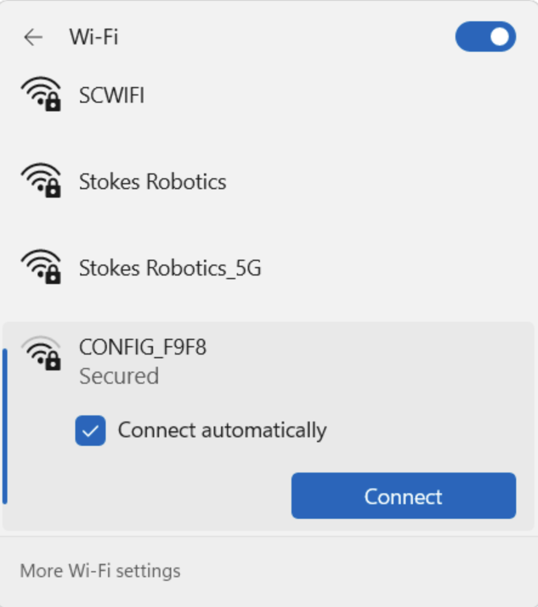
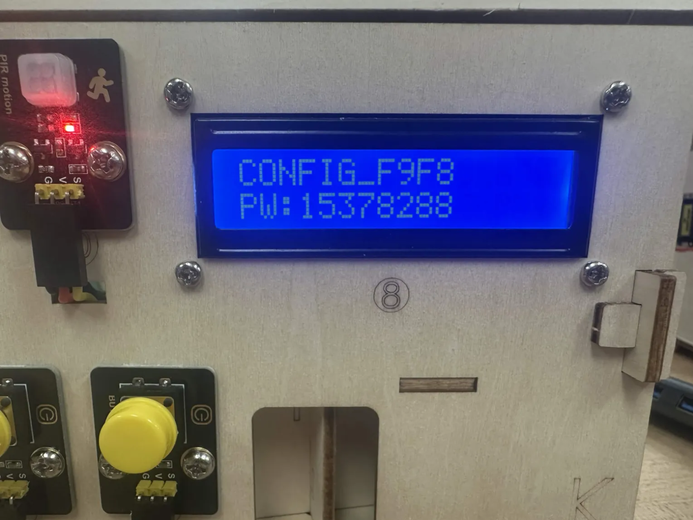
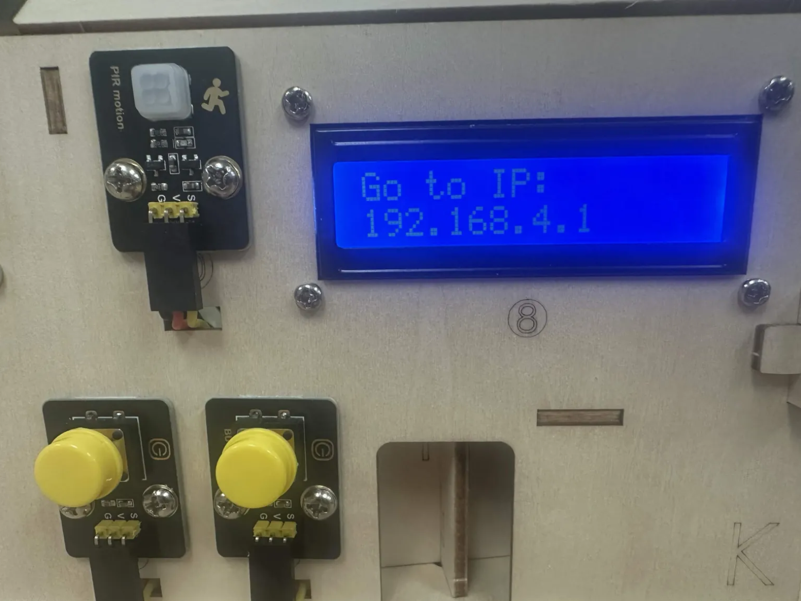
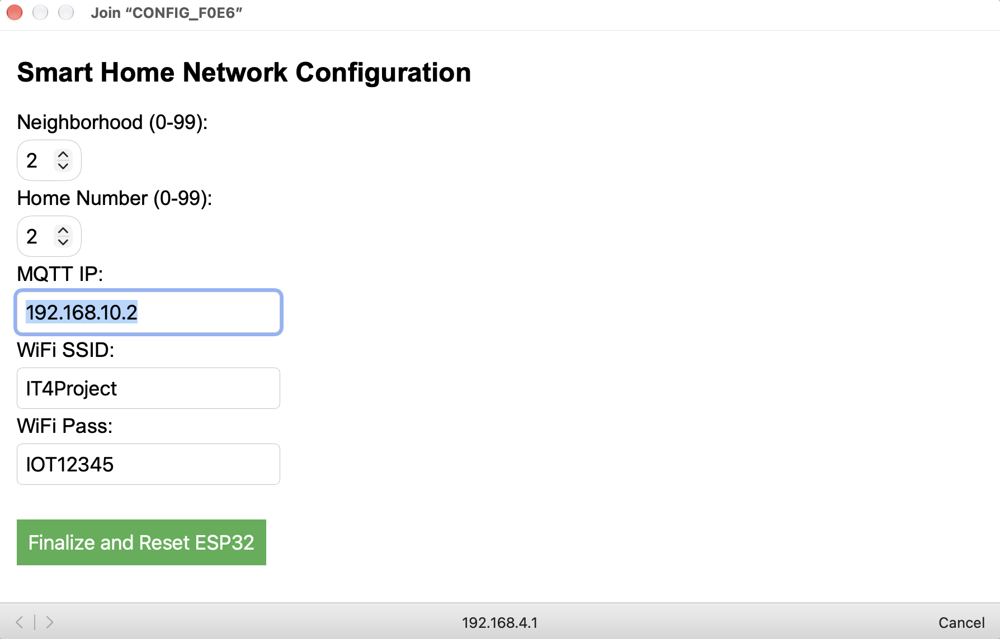

[Back to Main Menu](https://github.com/CCC-Industry4/IIOT-4.0-Project/tree/main)

*Instruction to teacher: Divide into pairs. One person reads/researches each step, while the other performs the actions. Each pair will work independently with their own Smart Home setup.*
# Configure Smart Home
---
1. Connect the demonstration PC to the Pi. Wi-Fi can be used on a PC or smartphone. The disadvantages of using Wi-Fi are that you will lose access to the internet. Connect to the following:
SSID (service set identifier): IT4Project
Password: IOT12345
2. Plug in and power up Smart Home.
3. Connect to the Wi-Fi address displayed on the Smart Home's LCD using a phone or laptop. 
	
	

Enter the SSID and password that appear on the screen

If this does not appear, reset the house while holding the two push buttons on the smart home to put the device back into setup mode.

4. Configure namespace of Smart Home using a web browser.
	While connected to the SSID, navigate to the IP listed on the LCD screen using a web browser.
	

      
      *The MQTT IP should match the one in the above picture unless you are hosting on a PC instead of a PI*
  -  Ask your instructor for the neighborhood and home number:
      -  Neighborhood number **should** be the same for the whole class.
      -  Home number **must** be unique for each home in the neighborhood.
      -  Unless otherwise told, leave the other settings as their defaults.
      - **Finalize and Reset ESP32.**

5. **Verify** that your Smart Home is working. 
  -  **Press CLOUD** then **LOCAL** buttons on the SCADA to cause the dropdown to include the new number.
  -  **Select** the new home number in the dropdown.
  -  If you see the count increasing simultaneously on the house and on the SCADA system on the web browser, you have successfully set up the Arduino Smart Home.
6. You can not have two smart homes with the same namespace.  If your home doesn’t connect, look at the namespace of working Smart Home. 
7. Demonstrate to your instructor.
